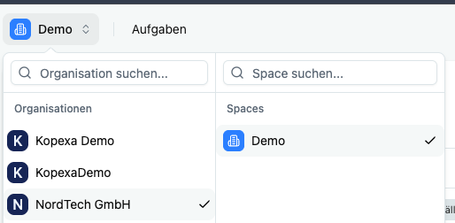
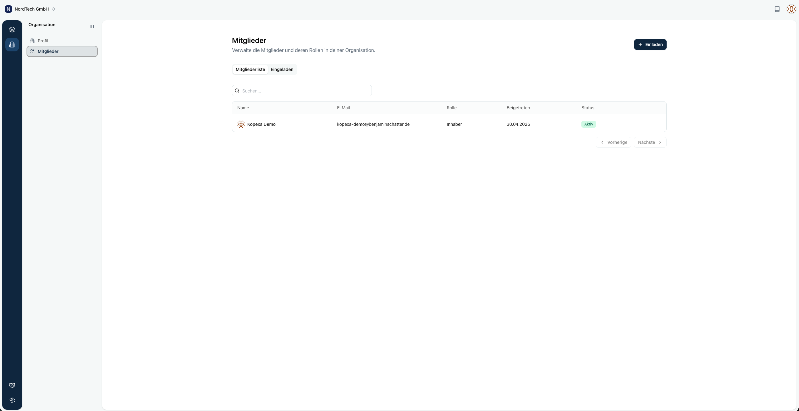
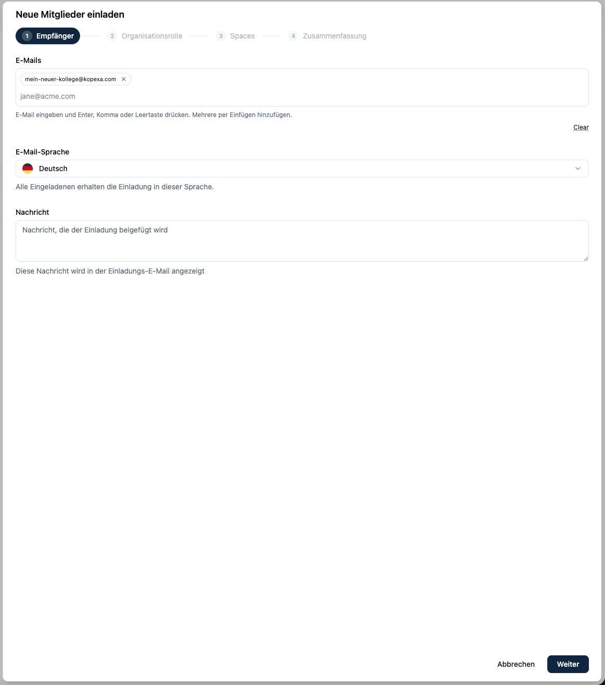
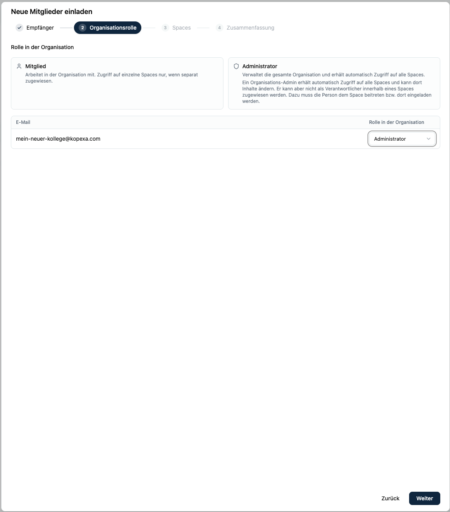
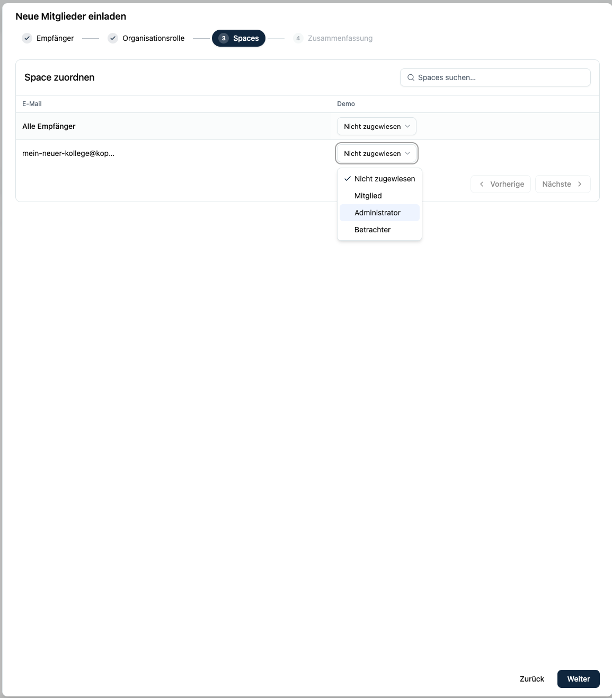
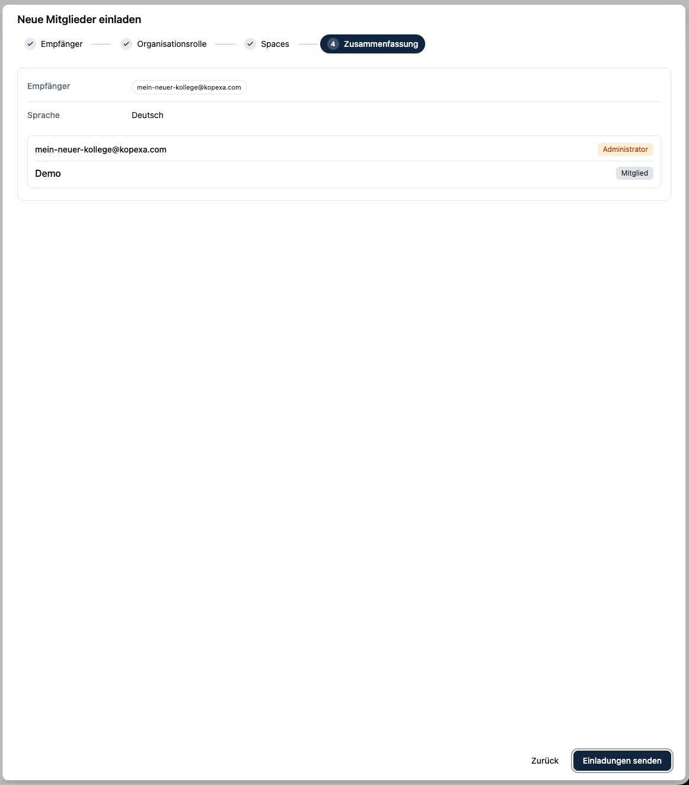
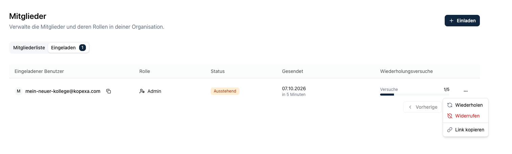
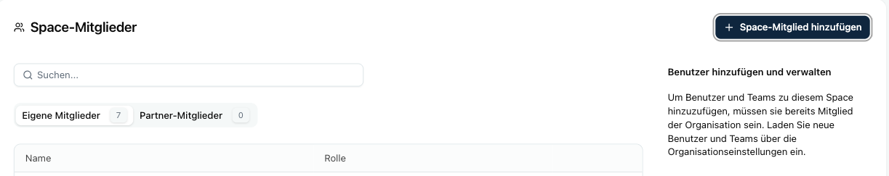
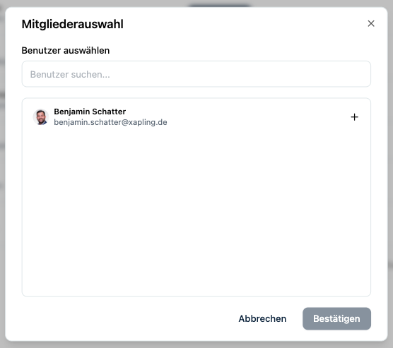

Eine Person, die in Kopexa arbeiten soll, braucht zwei Mitgliedschaften: eine in der Organisation und eine in jedem Space, in dem sie arbeiten soll. Beide vergibst du an unterschiedlichen Stellen.

| Wo | Was du dort tust |
|----|------------------|
| In der Organisation unter Organisation → Mitglieder | Neue Personen per E-Mail einladen, ihre Organisationsrolle festlegen und ihnen gleich Spaces zuordnen. Außerdem Einladungen und Mitglieder verwalten. |
| Im Space unter Einstellungen → Mitglieder | Personen, die schon Organisationsmitglied sind, in den Space holen, ihre Space-Rolle ändern oder sie aus dem Space entfernen. |

Neue Personen kommen nur über die Organisation in Kopexa. Im Space kannst du niemanden einladen, der noch kein Organisationsmitglied ist.

<Callout title="Spaces gleich bei der Einladung zuordnen">
Wer seine Einladung noch nicht angenommen hat, ist noch kein Organisationsmitglied und taucht deshalb im Space unter **Space-Mitglied hinzufügen** nicht auf. Ordnest du die Spaces erst später zu, musst du warten, bis die Person die Einladung angenommen hat, und danach noch einmal in die Space-Einstellungen gehen.

Wähle die Spaces deshalb direkt im Einladungsassistenten aus. Mit dem Annehmen der Einladung ist die Person dann Mitglied der Organisation und der gewählten Spaces.
</Callout>

---

## Rollen

### Rollen in der Organisation

| Rolle | Was sie darf |
|-------|--------------|
| Inhaber | Wie Administrator. Der Inhaber kann außerdem das Eigentum an der Organisation an ein anderes Mitglied übertragen. |
| Administrator | Verwaltet die Organisation, lädt Mitglieder ein und hat automatisch Zugriff auf alle Spaces. |
| Mitglied | Arbeitet nur in den Spaces, denen es zugeordnet ist. |

Ein Administrator kann in allen Spaces Inhalte ändern, auch ohne dort Mitglied zu sein. Als verantwortliche Person, etwa für ein Risiko oder eine Aufgabe, kannst du ihn in einem Space aber erst auswählen, wenn er Mitglied dieses Space ist. Ordne Administratoren deshalb den Spaces zu, in denen sie Verantwortung übernehmen.

### Rollen im Space

| Rolle | Was sie darf |
|-------|--------------|
| Betrachter | Liest alle Inhalte des Space. |
| Mitglied | Erstellt, bearbeitet und löscht Inhalte. |
| Administrator | Voller Zugriff. Verwaltet zusätzlich die Space-Einstellungen und die Mitglieder des Space. |

Wer als Erster in einen Space ohne Mitglieder kommt, wird dort automatisch Administrator.

---

## Neue Mitglieder einladen

Einladen können der Inhaber und die Administratoren der Organisation.

1. Klicke oben links auf den Selektor mit dem Namen des aktuellen Space. In der linken Spalte unter **Organisationen** wählst du deine Organisation aus.
   
2. Klicke in der Seitenleiste unter **Organisation** auf **Mitglieder**. Du siehst die **Mitgliederliste** und daneben unter **Eingeladen** alle offenen Einladungen.
   
3. Klicke oben rechts auf **Einladen**. Der Assistent „Neue Mitglieder einladen“ hat vier Schritte, mit **Weiter** kommst du zum nächsten.
4. **Empfänger**: Gib die E-Mail-Adressen ein. Nach jeder Adresse drückst du Enter, Komma oder Leertaste. Eine Liste kannst du auch auf einmal einfügen. Pro Vorgang sind bis zu 50 Adressen möglich. Wähle die Sprache der Einladungs-E-Mail (Deutsch oder Englisch) und füge bei Bedarf eine persönliche Nachricht hinzu.
   
5. **Organisationsrolle**: Oben erklärt Kopexa die beiden Rollen **Mitglied** und **Administrator**. Darunter wählst du für jede E-Mail-Adresse einzeln die **Rolle in der Organisation**. Vorausgewählt ist Mitglied.
   
6. **Spaces**: Die Tabelle **Space zuordnen** hat eine Spalte pro Space und eine Zeile pro E-Mail-Adresse. Pro Zelle wählst du **Nicht zugewiesen**, **Mitglied**, **Administrator** oder **Betrachter**. Was du in der Zeile **Alle Empfänger** einstellst, gilt für alle. In der Zeile einer einzelnen Adresse kannst du davon abweichen. Bei vielen Spaces hilft das Suchfeld **Spaces suchen…**, weitere Spaces erreichst du über **Nächste**.
   
7. **Zusammenfassung**: Prüfe Empfänger, Sprache, Rolle, Nachricht und Spaces. Klicke auf **Einladungen senden**.
   

Jede eingeladene Person bekommt eine E-Mail mit einem Link. Zum Annehmen meldet sie sich mit genau der E-Mail-Adresse an, an die die Einladung ging. Danach ist sie Mitglied der Organisation und der Spaces, die du im Schritt **Spaces** gewählt hast.

Kopexa lehnt Adressen von öffentlichen Mailanbietern und Wegwerf-Adressen ab. Lade Personen mit ihrer geschäftlichen E-Mail-Adresse ein.

---

## Offene Einladungen verwalten

In der Organisation unter **Organisation → Mitglieder** im Reiter **Eingeladen** siehst du alle Einladungen mit Status und der Zahl der bisherigen Versuche.

Pro Einladung hast du drei Aktionen:

- **Wiederholen** schickt die Einladung erneut. Kopexa erzeugt dabei einen neuen Link. Nach fünf Versuchen ist Schluss.
- **Widerrufen** macht die Einladung ungültig.
- **Link kopieren** gibt dir den Einladungslink. Den kannst du der Person direkt schicken, zum Beispiel wenn die E-Mail im Spamfilter hängt.

Bei angenommenen und widerrufenen Einladungen lassen sich **Wiederholen** und **Widerrufen** nicht mehr ausführen.

---

## Vorhandene Mitglieder einem Space zuordnen

So holst du Personen in einen Space, die schon Mitglied der Organisation sind. Das brauchen Space-Administratoren und Organisations-Administratoren.

1. Öffne den Space und klicke unten links in der Leiste auf **Einstellungen**.
2. Klicke in der Seitenleiste unter **Space-Einstellungen** auf **Mitglieder**. Du siehst die Liste der Space-Mitglieder mit ihrer Rolle.
   
3. Klicke oben rechts auf **Space-Mitglied hinzufügen**. Es öffnet sich die **Mitgliederauswahl**.
4. Suche die Personen über ihren Namen und füge sie mit **+** hinzu. Du kannst mehrere auswählen. Klicke dann auf **Bestätigen**.
   
5. Alle kommen mit der Rolle **Mitglied** in den Space. Soll jemand Betrachter oder Administrator sein, änderst du die Rolle anschließend über das Menü **…** in der Zeile der Person.

Die Auswahl zeigt nur Organisationsmitglieder, die noch nicht im Space sind. Personen mit offener Einladung findest du dort nicht.

Im Reiter **Partner-Mitglieder** stehen Personen aus Partner-Organisationen, die Zugriff auf diesen Space haben.

---

## Rollen ändern und Mitglieder entfernen

In der Organisation änderst du unter **Organisation → Mitglieder** in der **Mitgliederliste** über das Menü **…** die Rolle zwischen Mitglied und Administrator oder entfernst eine Person aus der Organisation. Deine eigene Zeile und die des Inhabers haben keine Aktionen. Der Inhaber kann in der Zeile eines anderen Mitglieds die Übertragung des Eigentums anstoßen. Die Übertragung wird wirksam, wenn das andere Mitglied sie bestätigt.

Im Space änderst du unter **Einstellungen → Mitglieder** über das Menü **…** die Space-Rolle oder entfernst eine Person aus dem Space. Sie bleibt dabei Mitglied der Organisation und behält ihre anderen Spaces.

---

## Anmeldung über SSO und Auto-Join

Hast du [SSO](./domains/setup.mdx) eingerichtet und an der Domain **Auto-Join** eingeschaltet, brauchst du für Personen dieser Domain keine Einladung. Sie werden beim ersten SSO-Login automatisch Mitglied der Organisation, mit der Rolle Mitglied.

Einen Space bekommen sie dadurch nicht. Ordne sie nach ihrem ersten Login wie oben beschrieben im Space unter **Einstellungen → Mitglieder** zu. Willst du die Spaces vorher festlegen, lade die Personen trotzdem über den Assistenten ein.

Ohne Auto-Join legt Kopexa beim ersten SSO-Login nur ein Konto an. In die Organisation kommt die Person erst über eine Einladung.

---

## Wenn etwas nicht klappt

| Problem | Ursache und Lösung |
|---------|--------------------|
| Eine Person fehlt in der Mitgliederauswahl des Space. | Sie hat ihre Einladung noch nicht angenommen oder ist schon im Space. Prüfe in der Organisation unter **Mitglieder → Eingeladen** den Status und schicke die Einladung bei Bedarf erneut. |
| Die Einladung wird mit dem Hinweis auf eine geschäftliche Adresse abgelehnt. | Die Adresse gehört zu einem öffentlichen Mailanbieter oder Wegwerf-Dienst. Nimm die Firmenadresse. |
| Die Person sieht beim Annehmen „E-Mail-Adresse stimmt nicht überein“. | Sie ist mit einer anderen Adresse angemeldet. Sie meldet sich ab und mit der eingeladenen Adresse wieder an. |
| **Wiederholen** funktioniert nicht mehr. | Die Einladung wurde schon fünfmal verschickt. Kopiere den Link und schicke ihn direkt. |
| Ein Administrator lässt sich nicht als Verantwortlicher auswählen. | Er hat Zugriff auf den Space, ist aber kein Mitglied. Füge ihn im Space unter **Einstellungen → Mitglieder** hinzu. |
| Jemand war früher im Space und hat nach erneuter Einladung die falsche Rolle. | Kopexa stellt bei einer erneuten Einladung die frühere Space-Rolle wieder her. Passe sie im Space unter **Einstellungen → Mitglieder** an. |

---

## Mitglieder, Personen und Geschäftsrollen

In Kopexa gibt es mehrere Listen mit Menschen. Anmelden können sich nur die Mitglieder.

- Mitglieder sind die Benutzer, die in Kopexa arbeiten. Sie verwaltest du wie auf dieser Seite beschrieben.
- [Personen](../../organization/people/index.mdx) sind Einträge im Inventar eines Space, zum Beispiel aus Entra ID importierte Beschäftigte mit ihren Konten. Eine Person bekommt dadurch keinen Zugang zu Kopexa.
- Personen können zusätzlich einen Zugang zum [Workforce Hub](../../workforce-hub/index.mdx) bekommen, dem Mitarbeiterportal, um dort Aufgaben zu erledigen. Das Portal ist von der Kopexa-App getrennt. Ein Portalzugang macht niemanden zum Mitglied.
- Geschäftsrollen unter **Organisation → Rollen** im Space beschreiben Rollen in deinen Prozessen. Sie vergeben keine Rechte in Kopexa.
- [Stakeholder](../../governance/stakeholders/index.mdx) sind interessierte Parteien deines Managementsystems und ebenfalls keine Benutzer.
