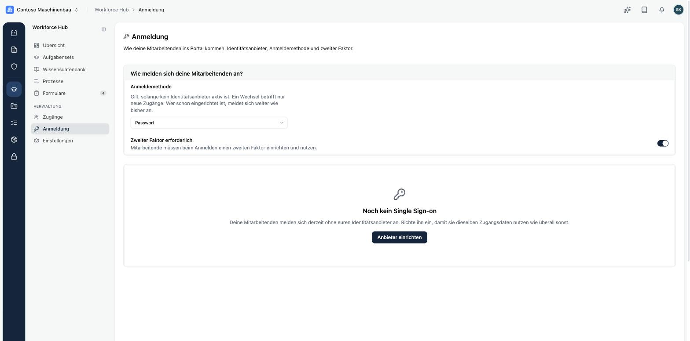
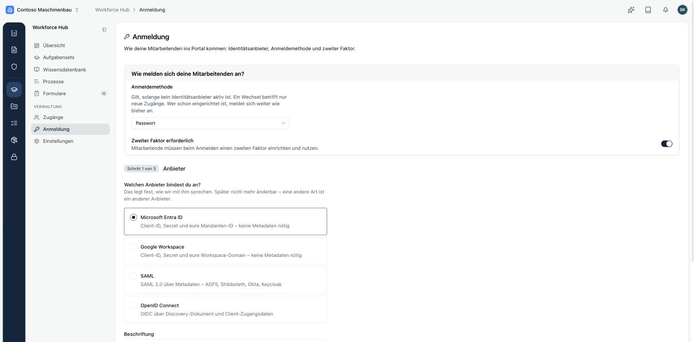

Unter **Workforce Hub → Anmeldung** legst du fest, wie sich deine Beschäftigten im Portal anmelden.

## Anmeldemethode

Solange kein Identitätsanbieter aktiv ist, melden sich deine Beschäftigten mit eigenen Zugangsdaten an:

- **Passwort**: Die Person legt bei der ersten Anmeldung ein Passwort fest.
- **Passkey**: Die Person meldet sich mit Fingerabdruck, Gesichtserkennung oder Geräte-PIN an. Ein Passkey ist schon zweistufig, ein zweiter Faktor ist dann nicht nötig.

Ein Wechsel der Methode betrifft nur neue Zugänge. Wer schon eingerichtet ist, meldet sich weiter wie bisher an.

## Zweiter Faktor

Mit **Zweiter Faktor erforderlich** müssen alle, die sich mit Passwort anmelden, einen zweiten Faktor einrichten und nutzen, etwa eine Authenticator-App. Verliert jemand das Gerät, setzt du den zweiten Faktor unter [Zugänge](./zugaenge) zurück.

## Single Sign-on

Mit Single Sign-on melden sich deine Beschäftigten mit demselben Konto an wie überall sonst im Unternehmen. Über **Anbieter einrichten** startest du einen Assistenten in drei Schritten.

| Anbieter | Was du brauchst |
|---|---|
| **Microsoft Entra ID** | Client-ID, Secret und Mandanten-ID |
| **Google Workspace** | Client-ID, Secret und Workspace-Domain |
| **SAML** | Metadaten, zum Beispiel aus ADFS, Shibboleth, Okta oder Keycloak |
| **OpenID Connect** | Discovery-Dokument und Client-Zugangsdaten |

Die Art des Anbieters lässt sich später nicht mehr ändern. Eine andere Art ist ein neuer Anbieter.

Ist ein Anbieter aktiv, gehen alle Anmeldungen direkt zu ihm. Eine Auswahl bekommen deine Beschäftigten nicht zu sehen. Die Einstellung zur Anmeldemethode bleibt als Rückfallweg erhalten, falls du Single Sign-on wieder abschaltest.

<Callout title="Domain-Freigaben im Blick behalten">
Die Anmeldung über euren Anbieter hängt an freigegebenen E-Mail-Domains. Fehlt für eine Domain der Eigentumsnachweis, erscheint das unter **Handlungsbedarf** in der Übersicht.
</Callout>

Mit aktivem Identitätsanbieter kannst du unter [Zugänge](./zugaenge) einstellen, dass Zugänge bei der ersten Anmeldung über SSO entstehen. Dann musst du niemanden einladen.
