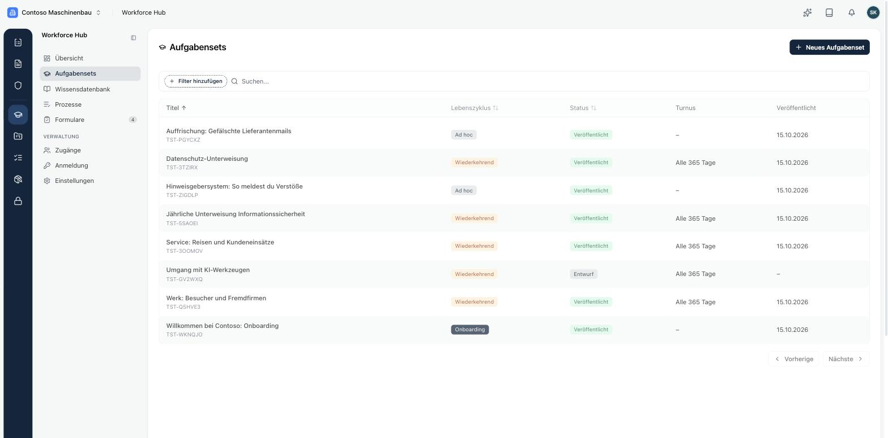
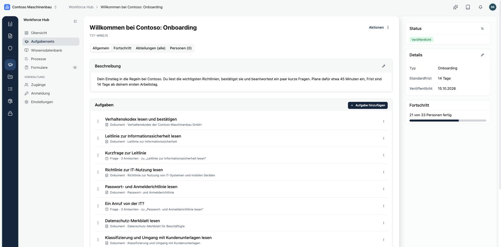
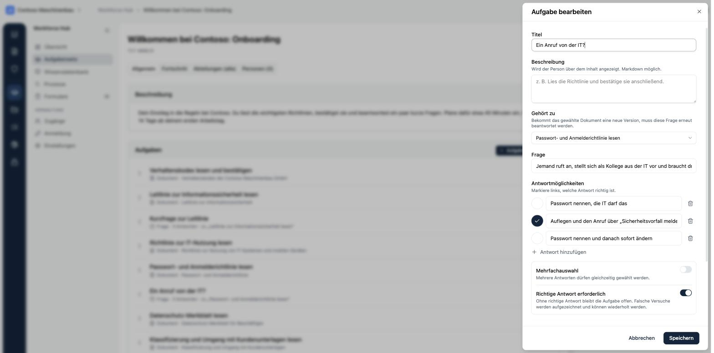
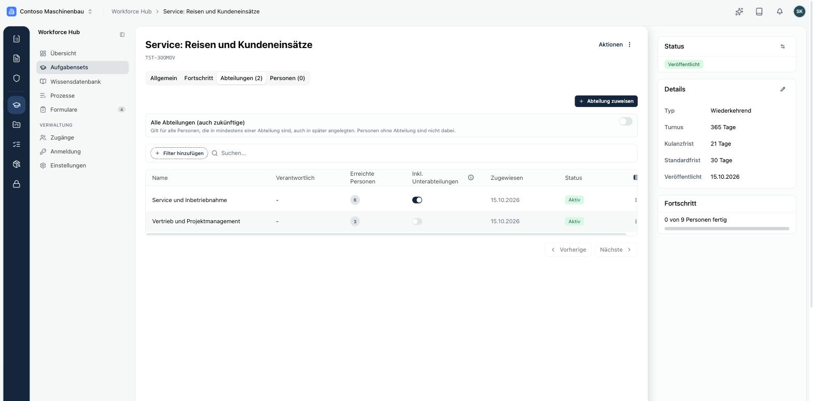
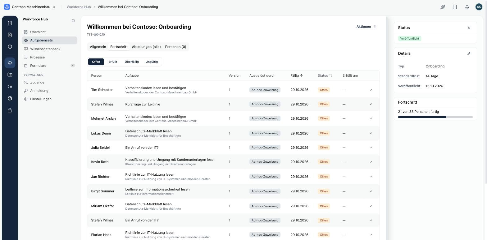
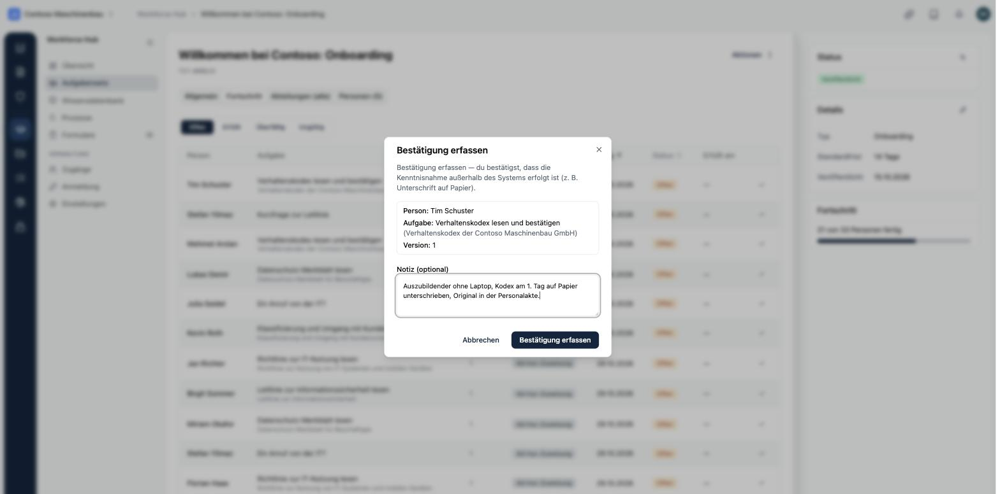

Ein **Aufgabenset** bündelt Aufgaben, die eine Person im Portal erledigen soll. Du findest die Sets unter **Workforce Hub → Aufgabensets**.

## Die drei Arten

| Lebenszyklus | Wofür | Beispiel |
|---|---|---|
| **Onboarding** | einmalig für neue Beschäftigte, Frist ab Eintritt | Verhaltenskodex, Leitlinie, IT-Nutzung, Passwörter, Datenschutz |
| **Wiederkehrend** | mit Turnus in Tagen, etwa jährlich, und Kulanzfrist | Jährliche Unterweisung Informationssicherheit |
| **Ad hoc** | einmalig aus aktuellem Anlass | Auffrischung nach einer gefälschten Lieferantenmail |

Für wiederkehrende Sets legst du den **Turnus** in Tagen und eine **Kulanzfrist** fest. Die Kulanzfrist muss kürzer sein als der Turnus. Die **Standardfrist** gibt an, wie viele Tage eine Person für das Set hat.

## Aufgaben

Über **Aufgabe hinzufügen** legst du eine Aufgabe an. Es gibt zwei Typen:

- **Dokument**: Die Person liest ein veröffentlichtes Kopexa-Dokument und bestätigt es mit **Gelesen und verstanden**. Die Bestätigung bezieht sich auf die aktuelle Version des Dokuments.
- **Frage**: eine Kontrollfrage mit zwei oder mehr Antworten. Du markierst die richtigen Antworten und legst fest, ob mehrere Antworten gewählt werden dürfen.

Eine Frage gehört zu einer Dokument-Aufgabe im selben Set (**Gehört zu**). Bekommt das Dokument eine neue Version, muss die Frage erneut beantwortet werden. Ist **Richtige Antwort erforderlich** eingeschaltet, schließt nur eine richtige Antwort die Aufgabe ab. Falsche Versuche werden aufgezeichnet, die Person kann es erneut versuchen.

Jede Aufgabe kann eine **Pflichtaufgabe** sein. Pflichtaufgaben zählen im persönlichen Fortschritt der Beschäftigten.

## Zuweisen

Im Reiter **Abteilungen** legst du fest, wer das Set bekommt:

- **Alle Abteilungen (auch zukünftige)**: Das Set gilt für alle Personen, die mindestens einer Abteilung angehören, auch für später angelegte Abteilungen. Personen ohne Abteilung sind nicht dabei.
- **Abteilung zuweisen**: einzelne Abteilungen. Mit **Inkl. Unterabteilungen** erreichst du auch alle Abteilungen darunter.
- Im Reiter **Personen** weist du ein Set einzelnen Personen zu.

## Veröffentlichen

Ein neues Set ist zunächst ein **Entwurf**. Über **Aktionen** veröffentlichst du es. Veröffentlichen kannst du nur, wenn das Set mindestens eine Aufgabe hat und jede Dokument-Aufgabe ein Dokument. Mit dem Veröffentlichen bekommen alle zugewiesenen Personen ihre Aufgaben. Nicht mehr benötigte Sets archivierst du.

<Callout title="Onboarding-Sets gehen an alle" type="warn">
Ein Onboarding-Set geht beim Veröffentlichen an alle Personen in den zugewiesenen Abteilungen, auch an langjährige Beschäftigte. Wenn ihr das nicht wollt, weise es zunächst nur einzelnen Personen zu.
</Callout>

## Fortschritt

Im Reiter **Fortschritt** siehst du je Person und Aufgabe, was offen, erfüllt, überfällig oder ungültig ist, mit Dokumentversion, Auslöser und Fälligkeit. Rechts zeigt die Karte **Fortschritt**, wie viele Personen das Set vollständig erledigt haben.

Eine Aufgabe wird **ungültig**, wenn eine neue Version des Dokuments veröffentlicht wird. Die Person bekommt dann eine neue Aufgabe für die neue Version.

## Bestätigung außerhalb des Systems erfassen

Hat jemand eine Richtlinie auf Papier unterschrieben, etwa eine Auszubildende ohne Laptop, klickst du in der Zeile auf das Häkchen. Im Dialog **Bestätigung erfassen** hältst du in einer Notiz fest, wie die Kenntnisnahme erfolgt ist.

