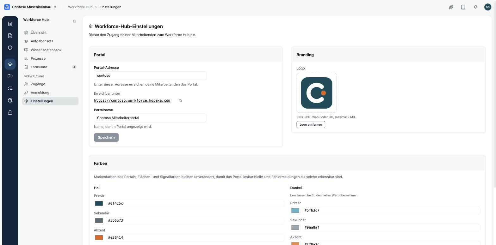
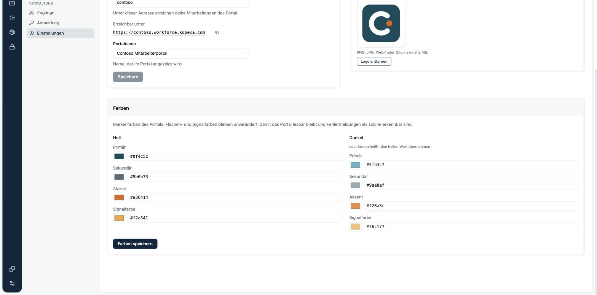

Unter **Workforce Hub → Einstellungen** legst du fest, unter welcher Adresse das Portal erreichbar ist und wie es aussieht.

## Portal

- **Portal-Adresse**: der vordere Teil der Adresse. Aus `contoso` wird `https://contoso.workforce.kopexa.com`. Erlaubt sind Kleinbuchstaben, Ziffern und Bindestriche. Manche Adressen sind reserviert oder schon vergeben.
- **Portalname**: der Name oben links im Portal, zum Beispiel „Contoso Mitarbeiterportal“.

<Callout title="Adresse mit Bedacht ändern" type="warn">
Änderst du die Portal-Adresse, funktionieren bereits verschickte Links und Lesezeichen nicht mehr. Lege sie am besten vor der ersten Einladung fest.
</Callout>

## Logo

Das Logo erscheint klein und quadratisch oben links im Portal. Ein Bildzeichen wirkt dort besser als ein breiter Schriftzug. Erlaubt sind PNG, JPG, WebP oder GIF bis 2 MB. Ein neues Logo ersetzt das alte, über **Logo entfernen** löschst du es.

## Farben

Für den hellen und den dunklen Modus legst du je vier Farben als Hex-Wert fest: **Primär**, **Sekundär**, **Akzent** und **Signalfarbe**. Lässt du die Werte für den dunklen Modus leer, übernimmt das Portal die hellen. Flächen- und Fehlerfarben bleiben unverändert, damit das Portal lesbar bleibt und Fehlermeldungen als solche erkennbar sind.

<Callout title="Was das Branding nicht erreicht">
Einladungsmails und die Anmeldeseiten tragen das Kopexa-Branding, nicht euer Logo und eure Farben.
</Callout>
