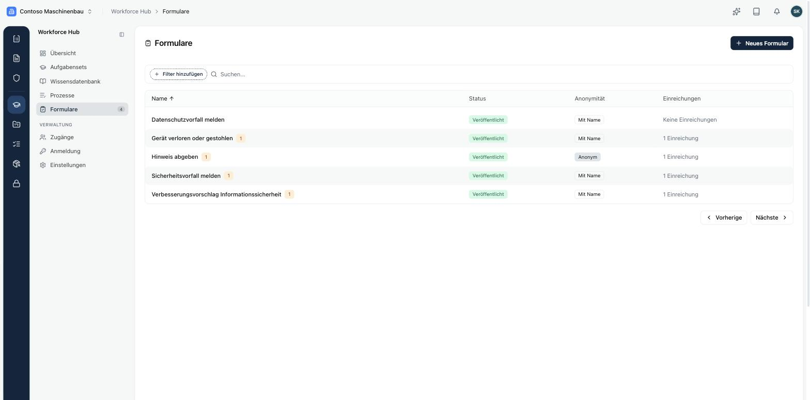
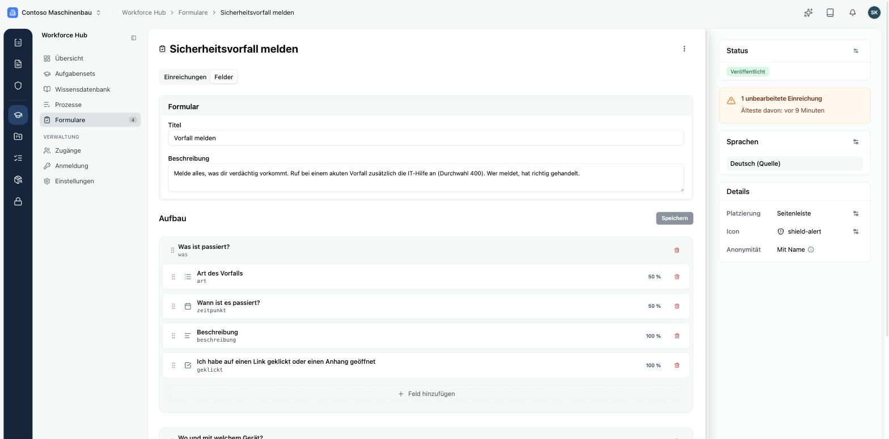
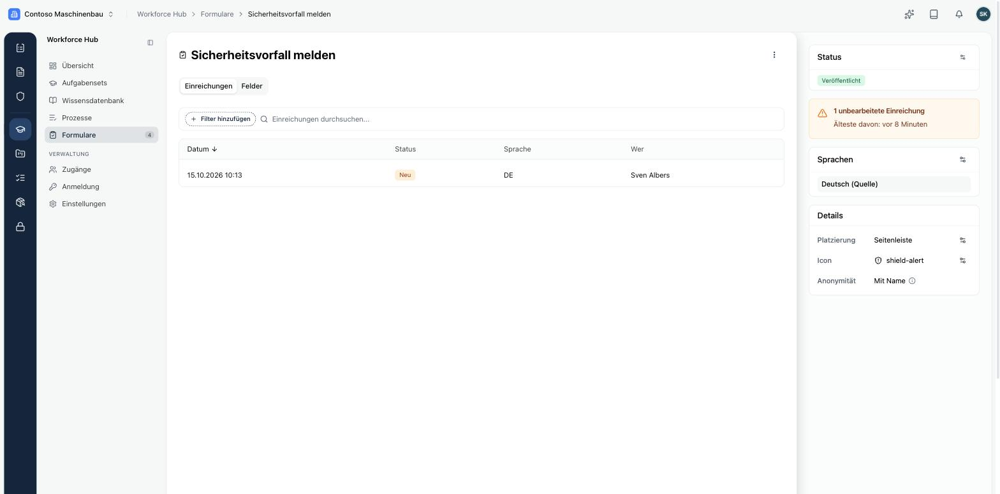
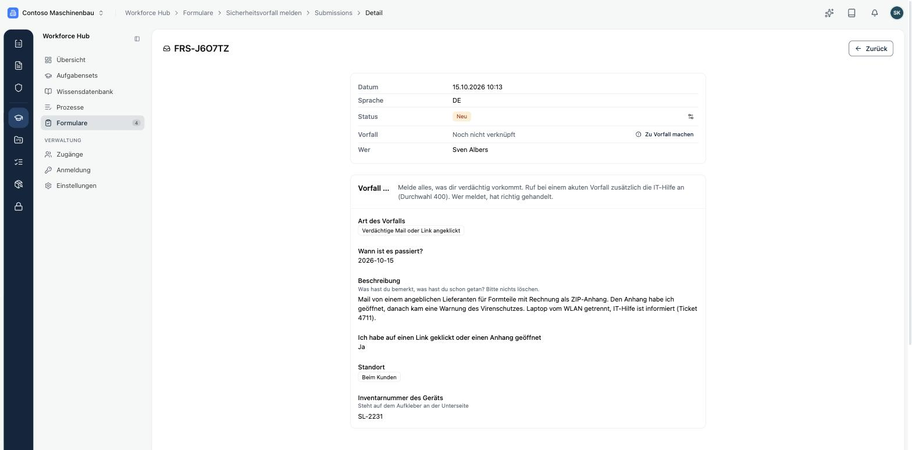
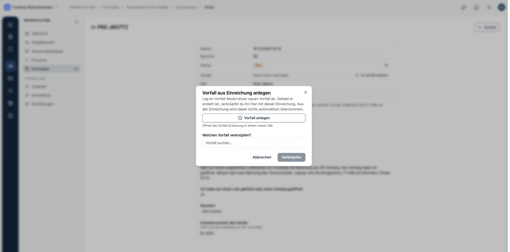

Mit **Formularen** gibst du deinen Beschäftigten feste Meldewege: Sicherheitsvorfall, verlorenes Gerät, Datenpanne, Hinweis nach Hinweisgeberschutzgesetz oder ein Verbesserungsvorschlag. Du findest sie unter **Workforce Hub → Formulare**.

## Formular anlegen

Über **Neues Formular** legst du drei Dinge fest:

- **Name**: ein interner Name. Deine Beschäftigten sehen ihn nie, im Portal steht der Titel aus dem Wortlaut.
- **Platzierung**: **Seitenleiste**, **Kopfbereich** oder **Kein Einstiegspunkt**. Ohne Einstiegspunkt erscheint das Formular nicht in der Navigation des Portals.
- **Anonymität**: ob erfasst wird, wer das Formular ausfüllt.

<Callout title="Anonymität lässt sich nicht mehr ändern" type="warn">
Bei einem anonymen Formular wird nicht erfasst, wer es ausgefüllt hat, und du kannst auf eine Einreichung nicht antworten. Bei einem Formular mit Namen siehst du die Person und kannst dich zurückmelden. Diese Entscheidung lässt sich nach dem Anlegen nicht mehr ändern.
</Callout>

Dazu wählst du ein Symbol für den Einstiegspunkt im Portal.

## Aufbau und Wortlaut

Im Reiter **Felder** baust du das Formular aus **Abschnitten** und **Feldern**. Oben stehen **Titel** und **Beschreibung**, die deine Beschäftigten über dem Formular lesen. Ohne Titel lässt sich das Formular nicht veröffentlichen.

| Feldtyp | Wofür |
|---|---|
| **Text** | kurze Angaben, etwa eine Inventarnummer |
| **Langtext** | Beschreibungen |
| **Auswahl** | genau eine Option aus einer Liste |
| **Mehrfachauswahl** | mehrere Optionen aus einer Liste |
| **Datum** | ein Zeitpunkt |
| **Checkbox** | eine Ja-Nein-Angabe |

Jedes Feld hat eine Beschriftung, einen optionalen Hilfetext, eine Breite (25, 33, 50, 75 oder 100 Prozent) und kann ein Pflichtfeld sein. Felder und Abschnitte ordnest du per Ziehen.

<Callout title="Kurze Titel">
Titel von Formularen in der Seitenleiste werden im Portal abgeschnitten, wenn sie zu lang sind. „Vorfall melden“ passt, „Sicherheitsvorfall melden“ nicht.
</Callout>

## Sprachen

Der Wortlaut eines Formulars liegt in einer Quellsprache. Unter **Sprachen** fügst du Übersetzungen hinzu, etwa Englisch für Beschäftigte, die das Portal auf Englisch nutzen.

## Veröffentlichen

Ein neues Formular ist ein **Entwurf** und im Portal unsichtbar. Über den **Status** veröffentlichst oder archivierst du es.

<Callout title="Löschen löscht alle Einreichungen" type="warn">
Löschst du ein Formular, sind auch alle Einreichungen dazu weg. Archiviere es lieber, wenn du es nicht mehr brauchst.
</Callout>

## Einreichungen bearbeiten

Neue Einreichungen siehst du an drei Stellen: als Zahl neben **Formulare** in der Navigation, unter **Handlungsbedarf** in der Übersicht und im Reiter **Einreichungen** des Formulars. Rechts zeigt das Formular, wie viele Einreichungen unbearbeitet sind und wie alt die älteste ist.

Eine Einreichung zeigt alle Angaben, Datum, Sprache und bei Formularen mit Namen die Person. Den **Status** setzt du auf **Neu**, **In Bearbeitung**, **Erledigt** oder **Verworfen**.

## Aus einer Einreichung einen Vorfall machen

Über **Zu Vorfall machen** legst du im Modul Vorfälle einen neuen Vorfall an und verknüpfst ihn mit der Einreichung, oder du verknüpfst einen bestehenden Vorfall. Aus der Einreichung wird dabei nichts automatisch übernommen. Bei anonymen Einreichungen bleibt die Anonymität erhalten, auch über den Vorfall kann niemand auf die Person schließen.

