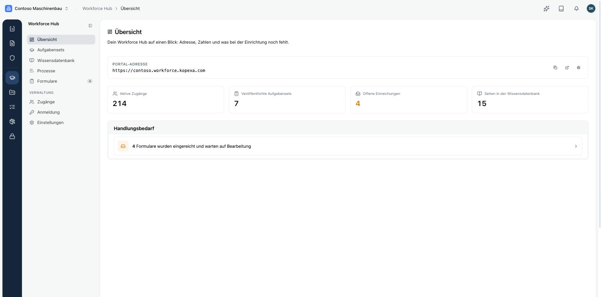

Der **Workforce Hub** verbindet dein ISMS mit allen Beschäftigten. Richtlinien, Prozesse und Unterweisungen pflegst du wie gewohnt in Kopexa. Im Portal sehen deine Beschäftigten genau den Teil davon, der sie betrifft: Sie lesen und bestätigen Richtlinien, beantworten Kontrollfragen, schlagen in einer Wissensdatenbank nach und melden Vorfälle über Formulare.

<Callout title="Kurz gesagt">
Jede Bestätigung, jede beantwortete Frage und jede Meldung landet als Nachweis in Kopexa. Im Audit musst du keine Unterschriftenlisten mehr zusammensuchen.
</Callout>

## Zwei Ansichten

| | Verwaltung | Portal |
|---|---|---|
| **Adresse** | app.kopexa.com, im Space unter **Workforce Hub** | eigene Adresse, zum Beispiel `https://contoso.workforce.kopexa.com` |
| **Wer arbeitet dort** | ISB, Compliance, Personal, IT | alle freigeschalteten Beschäftigten |
| **Was passiert dort** | Inhalte anlegen, zuweisen, freigeben, Fortschritt und Meldungen auswerten | Aufgaben erledigen, Dokumente bestätigen, nachschlagen, melden |
| **Anmeldung** | Kopexa-Konto | eigene Zugangsdaten, Passkey oder Single Sign-on |

Wie das Portal für deine Beschäftigten aussieht, steht im Bereich [Workforce Hub für Beschäftigte](/workforce-hub/portal).

## Freischaltung

Der Workforce Hub ist ein Zusatzprodukt. Kopexa schaltet ihn nach deiner Bestellung für einen Space frei. Danach findest du ihn in der linken Navigation des Space unter dem Symbol mit dem Doktorhut. Für die Abrechnung zählen nur Personen, die für den Workforce Hub freigeschaltet sind.

## Der Aufbau

Die **Übersicht** zeigt dir die Portal-Adresse, die Zahl der aktiven Zugänge, der veröffentlichten Aufgabensets, der offenen Einreichungen und der Seiten in der Wissensdatenbank. Unter **Handlungsbedarf** steht, was gerade deine Aufmerksamkeit braucht, zum Beispiel unbearbeitete Formulareinreichungen.

Die übrigen Menüpunkte:

- **Aufgabensets**: Richtlinien bestätigen lassen und Kontrollfragen stellen. Siehe [Aufgabensets](./aufgabensets.mdx).
- **Wissensdatenbank**: Seiten mit Anleitungen und Antworten auf Alltagsfragen. Siehe [Wissensdatenbank](./wissensdatenbank.mdx).
- **Prozesse**: Prozesse aus deinem Prozessregister für das Portal freigeben. Siehe [Prozesse](./prozesse.mdx).
- **Formulare**: Meldewege für Vorfälle, Datenpannen und Hinweise. Siehe [Formulare](./formulare.mdx).
- **Zugänge**: wer das Portal nutzen darf. Siehe [Zugänge](./zugaenge.mdx).
- **Anmeldung**: Passwort, Passkey, zweiter Faktor und Single Sign-on. Siehe [Anmeldung](./anmeldung.mdx).
- **Einstellungen**: Adresse, Name, Logo und Farben des Portals. Siehe [Einstellungen](./einstellungen.mdx).

Wenn du neu startest, folge der [Einrichtung Schritt für Schritt](./einrichtung.mdx).

## Welche Anforderungen du damit belegst

| Anforderung | Fundstelle | Im Workforce Hub |
|---|---|---|
| Richtlinien bekannt machen und Kenntnisnahme festhalten | ISO/IEC 27001:2022, Anhang A 5.1 | Aufgabe „Dokument bestätigen“ mit Bezug auf die Dokumentversion |
| Sensibilisierung und Schulung | ISO/IEC 27001 A 6.3, NIS-2 Art. 21 Abs. 2 Buchst. g | wiederkehrende Aufgabensets mit Kontrollfragen |
| Informationssicherheitsereignisse melden | ISO/IEC 27001 A 6.8 | Formular, das in Kopexa zum Vorfall wird |
| Interne Meldestelle | Hinweisgeberschutzgesetz § 12 | anonymes Formular |
| Datenpannen melden | DSGVO Art. 33 | eigenes Meldeformular |
| Dokumentierte Abläufe verfügbar machen | ISO/IEC 27001 A 5.37 | freigegebene Prozesse mit Ablaufplan |
