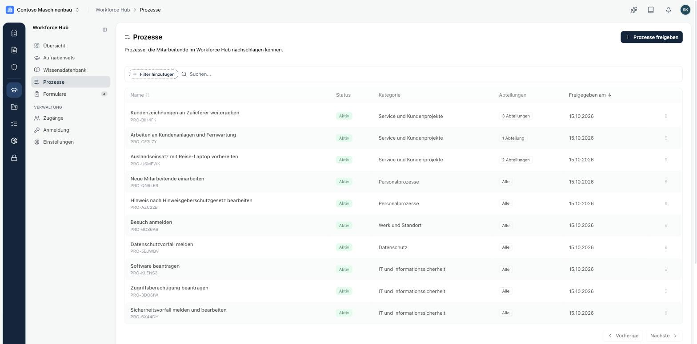
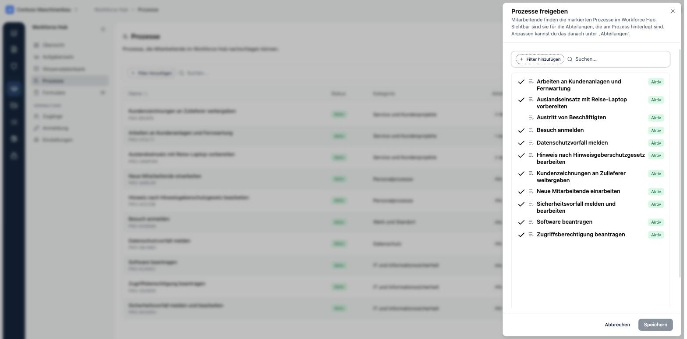
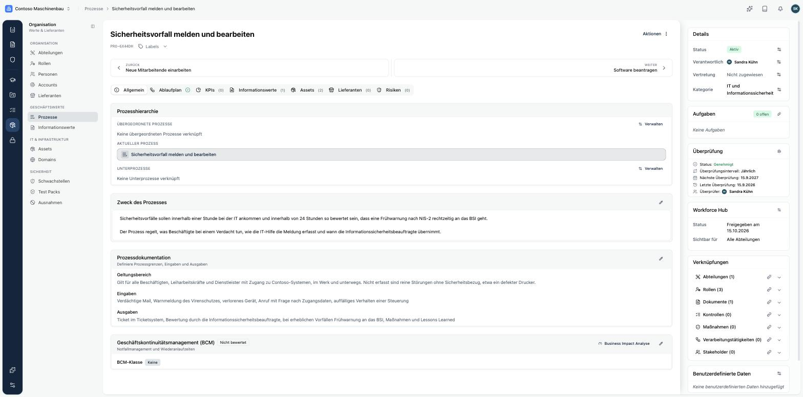

Im Workforce Hub legst du keine neuen Prozesse an. Du gibst Prozesse aus deinem [Prozessregister](/platform/organization/processes) für das Portal frei. Name, Kategorie, Zweck, Geltungsbereich, Ein- und Ausgaben, Verantwortlicher und Ablaufplan kommen direkt aus dem Prozess. Änderst du dort etwas, sehen deine Beschäftigten es sofort.

## Prozesse freigeben

Unter **Workforce Hub → Prozesse** öffnest du über **Prozesse freigeben** die Auswahl. Markiere die Prozesse, die deine Beschäftigten kennen sollen, und speichere.

Interne Abläufe, etwa die Bearbeitung eines Austritts durch die Personalabteilung, bleiben unmarkiert und damit intern.

## Wer einen Prozess sieht

Ein freigegebener Prozess ist zunächst für die Abteilungen sichtbar, die am Prozess hinterlegt sind. Die Spalte **Abteilungen** zeigt, wie viele es sind oder ob er für alle gilt. Über das Menü der Zeile passt du das an:

- **Alle Abteilungen (auch zukünftige)**: Der Prozess ist für alle Beschäftigten sichtbar.
- **Inkl. Unterabteilungen**: Je Abteilung erreichst du auch alle Abteilungen darunter.

<Callout title="Prozess ohne Abteilung">
Hat ein Prozess keine Abteilung und ist **Alle Abteilungen** nicht eingeschaltet, sieht ihn im Portal niemand.
</Callout>

## Der Ablaufplan im Portal

Hast du zum Prozess einen [Ablaufplan (BPMN)](/platform/organization/processes/bpmn) hinterlegt, sehen deine Beschäftigten ihn im Portal im Reiter **Ablaufplan**. Am besten verständlich sind Diagramme mit einem Pool je Rolle, etwa Beschäftigte, IT-Hilfe und Informationssicherheitsbeauftragte, die über Nachrichtenflüsse verbunden sind.

## Freigabe im Prozess selbst

Auf der Detailseite eines Prozesses zeigt die Karte **Workforce Hub**, ob und seit wann der Prozess freigegeben ist und für wen er sichtbar ist.

