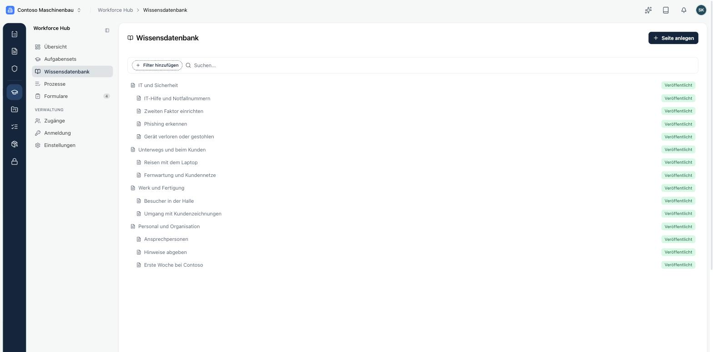
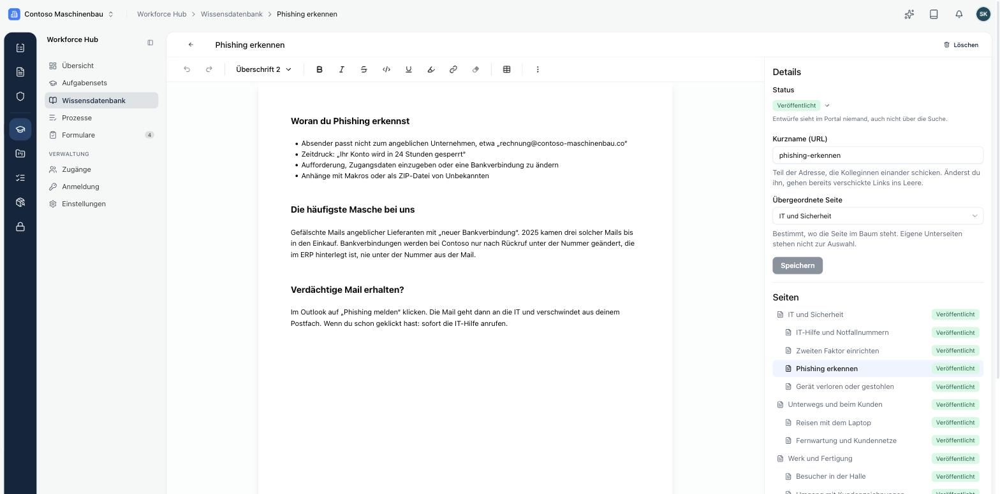

Die **Wissensdatenbank** ist ein Baum aus Themen und Seiten. Deine Beschäftigten finden dort Antworten, ohne die IT oder die Personalabteilung anzurufen: wer bei einem Notfall zuständig ist, wie der zweite Faktor eingerichtet wird, was bei einem verlorenen Laptop zu tun ist.

## Seiten anlegen

Über **Seite anlegen** erstellst du eine neue Seite. Du schreibst im gleichen Editor wie bei Kopexa-Dokumenten, mit Überschriften, Listen, Tabellen und Links.

Rechts im Bereich **Details** legst du fest:

- **Status**: **Entwurf**, **Veröffentlicht** oder **Archiviert**. Entwürfe sieht im Portal niemand, auch nicht über die Suche.
- **Kurzname (URL)**: der Teil der Adresse, über den die Seite erreichbar ist. Änderst du ihn, funktionieren bereits geteilte Links nicht mehr.
- **Übergeordnete Seite**: wo die Seite im Baum steht.

## Struktur

Es gibt keine eigenen Kategorien. Struktur entsteht über den Baum: Lege für jedes Thema eine Seite an, etwa „IT und Sicherheit“, und ordne die Einzelseiten darunter. Die Themen erscheinen im Portal als Einstieg auf der Startseite und in der Navigation der Wissensdatenbank.

<Callout title="Veröffentlichte Eltern">
Eine Seite ist im Portal nur sichtbar, wenn auch alle übergeordneten Seiten veröffentlicht sind.
</Callout>

## Zielgruppen

Eine Seite kann auf Abteilungen beschränkt werden. Unterseiten erben die Zielgruppe der nächsten übergeordneten Seite, die eine hat. Eine Seite, für die auf dem ganzen Weg bis zum Thema keine Zielgruppe gesetzt ist, sehen alle Beschäftigten.

Beispiel: Das Thema „Unterwegs und beim Kunden“ ist auf Service und Vertrieb beschränkt. Alle Seiten darunter sehen nur diese beiden Abteilungen. Im Portal erscheinen sie dort zusätzlich unter **Artikel für dich**.
