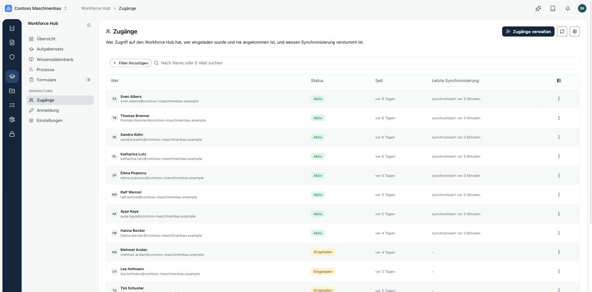
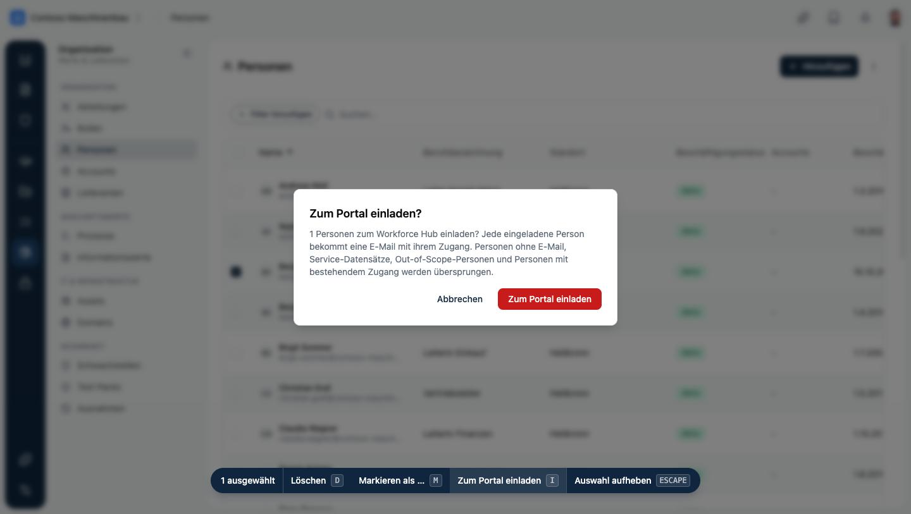
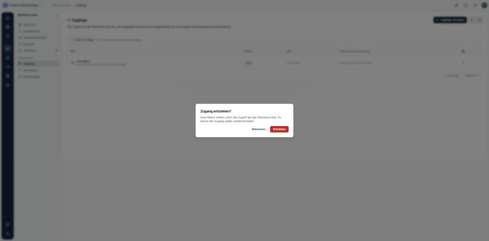

Ein **Zugang** gibt einer Person aus dem [Personenverzeichnis](/platform/organization/people) Zugriff auf das Portal. Ein Zugang macht niemanden zum Mitglied in Kopexa: Die Person kommt nur ins Portal, nicht in die App. Für die Abrechnung zählen nur Personen mit Zugang.

Unter **Workforce Hub → Zugänge** siehst du, wer Zugriff hat, wer eingeladen wurde und noch nicht angekommen ist und bei wem die Synchronisierung mit der Anmeldung fehlschlägt.

| Status | Bedeutung |
|---|---|
| **Eingeladen** | Die Einladung ist verschickt, der Zugang ist noch nicht eingerichtet. |
| **Aktiv** | Die Person kann sich im Portal anmelden. |
| **Deaktiviert** | Der Zugang ist entzogen. |

## Personen einladen

Einladen kannst du Personen mit dem Typ **Mitarbeiter:in**, einer E-Mail-Adresse und im Geltungsbereich. Externe nur, wenn **Externe einladbar** eingeschaltet ist. Service-Konten nie.

Unter **Organisation → Personen** gibt es zwei Wege:

- **Einzeln**: im Menü der Zeile **Zum Portal einladen**.
- **Mehrere**: Personen markieren und in der Leiste unten **Zum Portal einladen** wählen. Personen ohne E-Mail, Service-Datensätze, Personen außerhalb des Geltungsbereichs und Personen mit bestehendem Zugang werden übersprungen.

Die Spalte **Portal-Zugang** im Personenverzeichnis zeigt, wer schon einen Zugang hat.

Die eingeladene Person bekommt eine E-Mail mit dem Link **Zugang einrichten**. Der Link ist 12 Stunden gültig. Hat sie schon ein Konto, zum Beispiel aus einem anderen Workforce Hub, bekommt sie stattdessen den Hinweis, sich mit dem bestehenden Zugang anzumelden. Wie es für die Person weitergeht, steht unter [Erste Anmeldung](/workforce-hub/portal/erste-anmeldung).

Nicht angenommene Einladungen erscheinen nach einigen Tagen unter **Handlungsbedarf** in der Übersicht.

## Wie Zugänge entstehen

Über das Zahnrad oben rechts auf der Seite **Zugänge** legst du fest, wie Zugänge entstehen:

| Einstellung | Wirkung |
|---|---|
| **Nur auf Einladung** | Zugänge entstehen nur, wenn du eine Person einlädst. |
| **Automatisch** | Wird eine Person angelegt, auch per Verzeichnis-Sync, oder ändern sich Typ, E-Mail oder Geltungsbereich, bekommt sie automatisch eine Einladung. Externe und Service-Konten nie. Personen, die schon vorher angelegt waren, lädst du selbst ein. |
| **Bei der ersten Anmeldung über SSO** | Der Zugang entsteht, wenn sich jemand zum ersten Mal über euren Identitätsanbieter anmeldet. Möglich, sobald ein Identitätsanbieter aktiv ist. |
| **Aus** | Es entstehen keine neuen Zugänge. Bestehende funktionieren weiter. |

Dort schaltest du auch **Externe einladbar** ein. Das ist standardmäßig aus.

## Zugang entziehen

Im Menü der Zeile wählst du **Zugang entziehen**. Die Person verliert den Zugriff sofort: Beim nächsten Seitenaufruf sieht sie im Portal den Hinweis, dass sie keinen Zugang hat. Du kannst den Zugang später wiederherstellen.

Scheidet eine Person aus, weil ihr Enddatum vorbei ist, sie als **Ehemalig** markiert oder gelöscht wird, wird ihr Zugang automatisch entzogen. Das gilt auch, wenn die Vergabe neuer Zugänge auf **Aus** steht.

## Zweiten Faktor zurücksetzen

Hat jemand das Handy mit dem Authenticator verloren, wählst du im Menü der Zeile **Zweiten Faktor zurücksetzen**. Die Person richtet beim nächsten Anmelden einen neuen ein. Das Passwort bleibt unverändert.

## Synchronisierung

Zugänge werden mit dem Anmeldedienst abgeglichen. Schlägt das fehl, siehst du es in der Spalte **Letzte Synchronisierung** und unter **Handlungsbedarf**. Über die Schaltfläche mit den Pfeilen oben rechts startest du einen Abgleich von Hand.
