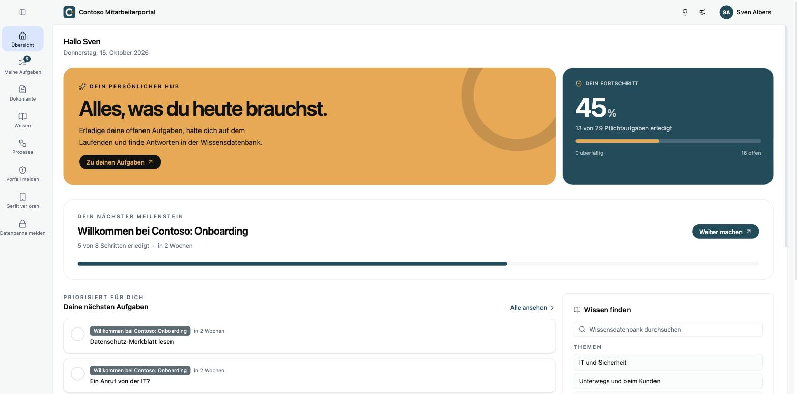

Der **Workforce Hub** ist das Mitarbeiterportal zu Kopexa. Im Portal lesen und bestätigen Beschäftigte Richtlinien, beantworten Kontrollfragen, schlagen in einer Wissensdatenbank nach und melden Vorfälle oder Hinweise. Alles, was sie dort tun, landet als Nachweis im Kopexa-Space ihres Unternehmens.

## Für wen ist welcher Teil?

<Cards>
  <Card title="Für Admins" href="/workforce-hub/admin/einrichtung">
    Du richtest das Portal in Kopexa ein: Aufgabensets, Wissensdatenbank, Prozesse, Formulare, Zugänge, Anmeldung und Erscheinungsbild.
  </Card>
  <Card title="Für Beschäftigte" href="/workforce-hub/portal">
    Du nutzt das Portal: erste Anmeldung, Aufgaben erledigen, Richtlinien bestätigen, nachschlagen und melden.
  </Card>
</Cards>

## Wo ist was?

| | Verwaltung | Portal |
|---|---|---|
| **Adresse** | app.kopexa.com, im Space unter **Workforce Hub** | eigene Adresse deines Unternehmens, zum Beispiel `https://contoso.workforce.kopexa.com` |
| **Wer arbeitet dort** | ISB, Compliance, Personal, IT | alle freigeschalteten Beschäftigten |
| **Anmeldung** | Kopexa-Konto | eigene Zugangsdaten, Passkey oder Single Sign-on |

Die Anleitung für Admins findest du auch im Bereich [Platform](/platform/workforce-hub), zusammen mit dem Rest der Kopexa-Doku.

<Callout title="Beispieldaten">
Alle Screenshots zeigen das fiktive Unternehmen Contoso Maschinenbau.
</Callout>
