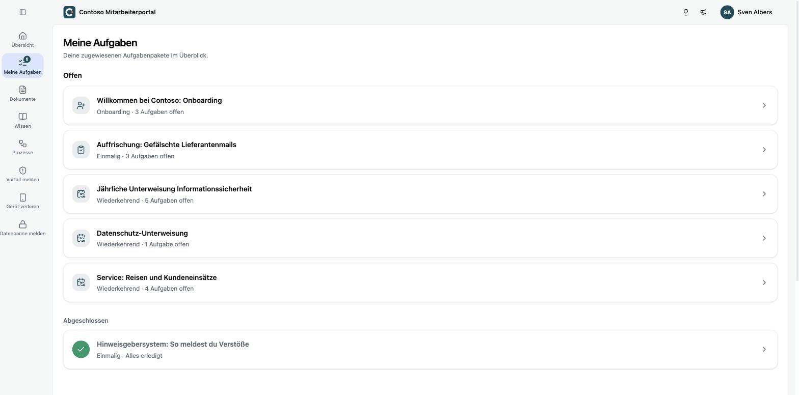
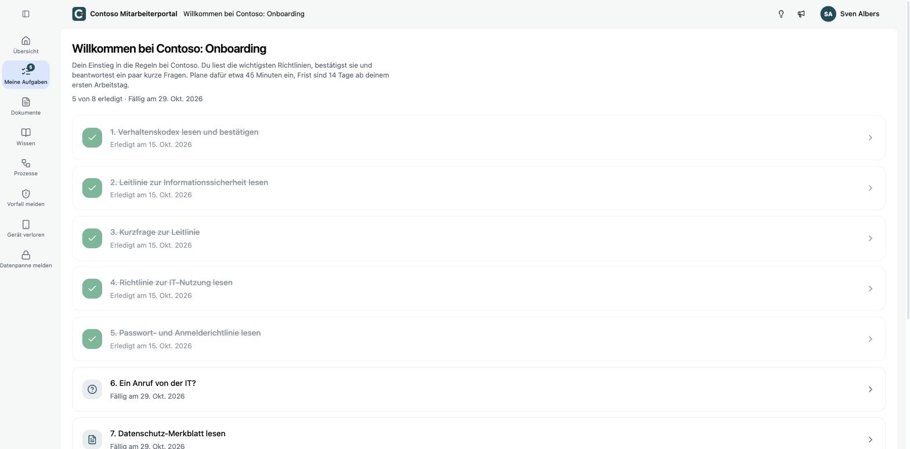
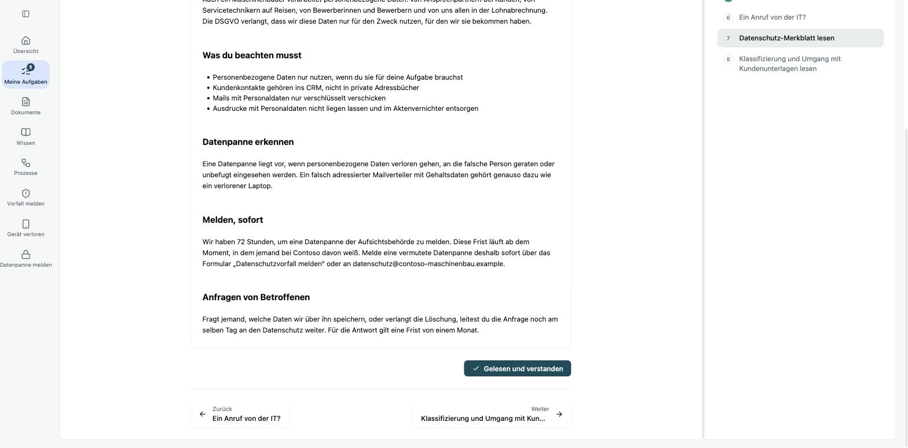
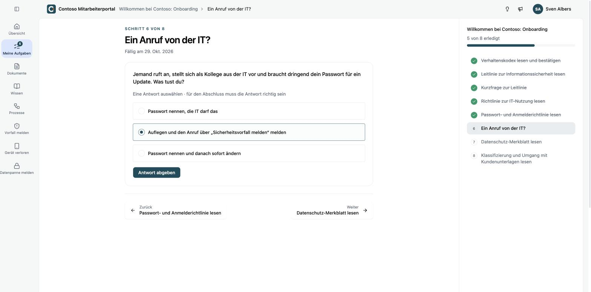
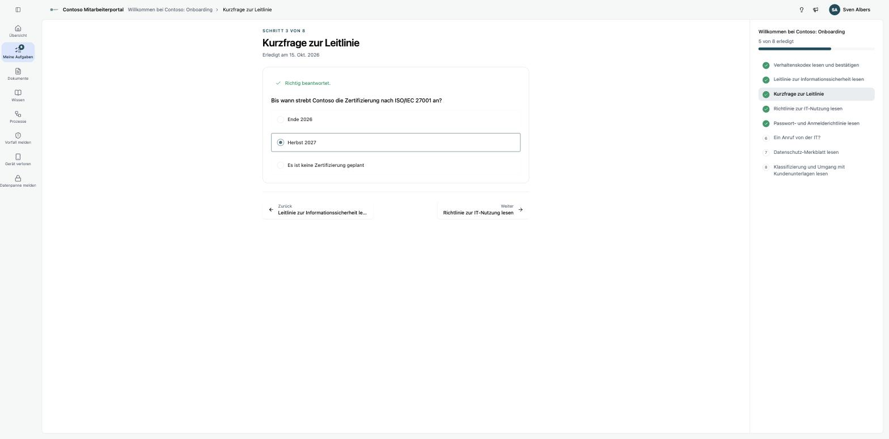

Unter **Meine Aufgaben** findest du alle Aufgabenpakete, die dir zugewiesen sind. Oben stehen die offenen, darunter die abgeschlossenen.

| Art | Was das bedeutet |
|---|---|
| **Onboarding** | Aufgaben für deinen Einstieg, mit einer Frist ab deinem Eintritt |
| **Wiederkehrend** | kommt regelmäßig wieder, zum Beispiel die jährliche Unterweisung |
| **Einmalig** | aus einem aktuellen Anlass, zum Beispiel nach einem Phishing-Versuch |

## Ein Paket abarbeiten

Öffne ein Paket. Du siehst alle Schritte mit ihrer Fälligkeit, erledigte Schritte sind abgehakt.

Arbeite die Schritte am besten der Reihe nach ab. In jedem Schritt zeigt dir die Liste rechts, wo du stehst. Über **Zurück** und **Weiter** unten wechselst du zwischen den Schritten.

## Ein Dokument bestätigen

Lies das Dokument bis zum Ende und klicke auf **Gelesen und verstanden**.

Mit der Bestätigung hältst du fest, dass du die Richtlinie in dieser Fassung kennst. Ändert dein Unternehmen die Richtlinie später, bekommst du die neue Fassung erneut zur Bestätigung.

## Eine Kontrollfrage beantworten

Viele Dokumente haben eine kurze Frage dazu. Wähle deine Antwort und klicke auf **Antwort abgeben**. Bei manchen Fragen sind mehrere Antworten richtig, das steht dann über den Antworten.

Ist die Antwort richtig, ist der Schritt erledigt. Ist sie falsch, versuchst du es noch einmal. Dein Unternehmen sieht, wie viele Versuche du gebraucht hast.

