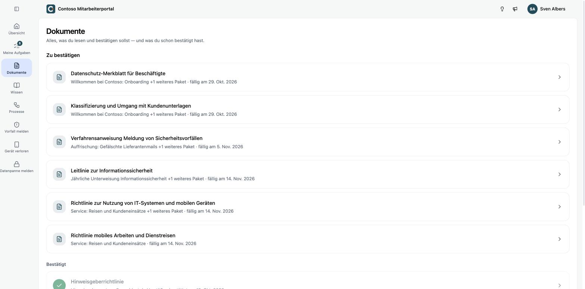

Unter **Dokumente** siehst du alle Richtlinien, die dir über deine Aufgabenpakete zugewiesen sind, unabhängig vom Paket.

- **Zu bestätigen**: Dokumente, die noch offen sind, mit dem Paket, zu dem sie gehören, und der Fälligkeit. Gehört ein Dokument zu mehreren Paketen, steht das dabei, zum Beispiel „+1 weiteres Paket“. Eine Bestätigung zählt dann für alle.
- **Bestätigt**: Dokumente, die du schon bestätigt hast, mit dem Datum.

Öffnest du ein Dokument, liest und bestätigst du es wie unter [Aufgaben](./aufgaben.mdx) beschrieben.
