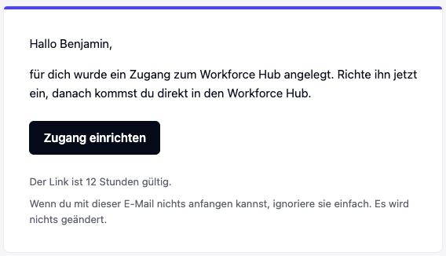
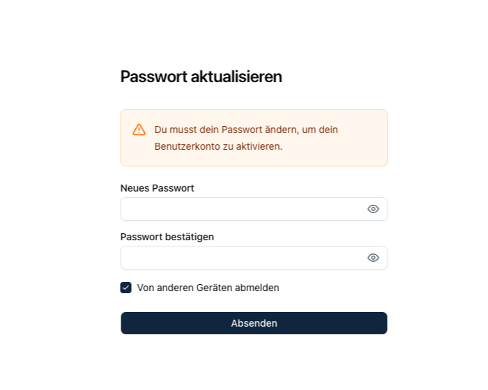
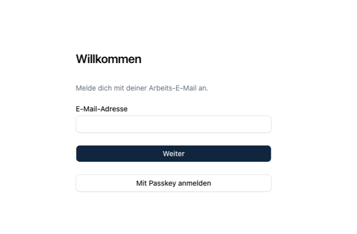

## Die Einladung

Wenn dein Unternehmen dir einen Zugang einrichtet, bekommst du eine E-Mail von Kopexa mit dem Link **Zugang einrichten**.

Klicke auf **Zugang einrichten**. Der Link ist 12 Stunden gültig. Ist er abgelaufen, bitte die zuständige Person in deinem Unternehmen, dich erneut einzuladen.

<Callout title="Du hast schon ein Konto?">
Wenn du schon einen Zugang zu einem anderen Workforce Hub hast, bekommst du keine Einrichtungsmail, sondern einen Hinweis mit dem Link zum Portal. Melde dich dort mit deinem bestehenden Zugang an.
</Callout>

## Passwort festlegen

Nach dem Klick auf den Link bestätigst du die Aktion **Passwort aktualisieren** und legst dein Passwort fest.

Danach siehst du **Konto aktualisiert**. Über **Zurück zur Applikation** geht es weiter zur Anmeldung.

Je nach Einstellung deines Unternehmens richtest du statt eines Passworts einen Passkey ein, also eine Anmeldung mit Fingerabdruck, Gesichtserkennung oder Geräte-PIN. Verlangt dein Unternehmen einen zweiten Faktor, richtest du ihn bei der ersten Anmeldung mit einer Authenticator-App ein.

## Anmelden

Gib deine Arbeits-E-Mail-Adresse ein und klicke auf **Weiter**, oder melde dich über **Mit Passkey anmelden** an. Nutzt dein Unternehmen Single Sign-on, landest du direkt bei der gewohnten Anmeldung, etwa bei Microsoft.

<Callout title="Ein eigener Zugang">
Dein Portalzugang ist unabhängig von einem Konto in der Kopexa-App. Über das Portal kommst du nicht in die App.
</Callout>
