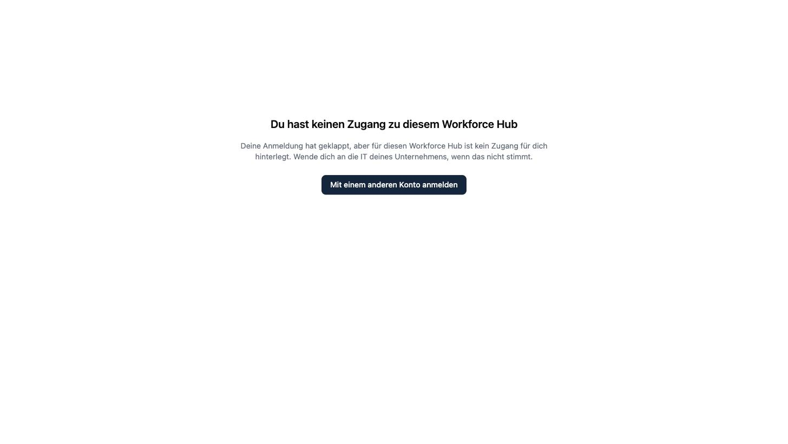

### Mein Einladungslink funktioniert nicht mehr.

Der Link ist 12 Stunden gültig. Bitte die zuständige Person in deinem Unternehmen, dich erneut einzuladen.

### Ich habe mein Handy mit dem Authenticator verloren.

Wende dich an die zuständige Person in deinem Unternehmen. Sie setzt deinen zweiten Faktor zurück, und du richtest beim nächsten Anmelden einen neuen ein. Dein Passwort bleibt gleich.

### Ich sehe „Du hast keinen Zugang zu diesem Workforce Hub“.

Deine Anmeldung hat geklappt, für dieses Portal ist aber kein Zugang für dich hinterlegt. Das passiert zum Beispiel, wenn dein Zugang entzogen wurde oder du mit einem anderen Konto angemeldet bist. Über **Mit einem anderen Konto anmelden** wechselst du das Konto. Stimmt etwas nicht, wende dich an die IT deines Unternehmens.

### Kann ich das Portal auf Englisch nutzen?

Ja. Über deinen Namen oben rechts wechselst du die Sprache.

### Warum sehe ich eine Richtlinie noch einmal, die ich schon bestätigt habe?

Dein Unternehmen hat eine neue Fassung veröffentlicht oder fragt die Bestätigung regelmäßig neu ab, etwa jährlich.

### Wer sieht meine Antworten auf die Kontrollfragen?

Die zuständigen Personen in deinem Unternehmen sehen, welche Aufgaben du erledigt hast und wie viele Versuche du für eine Frage gebraucht hast.

### Komme ich über das Portal in die Kopexa-App?

Nein. Das Portal ist von der Kopexa-App getrennt. Dein Portalzugang gilt nur für das Portal.
