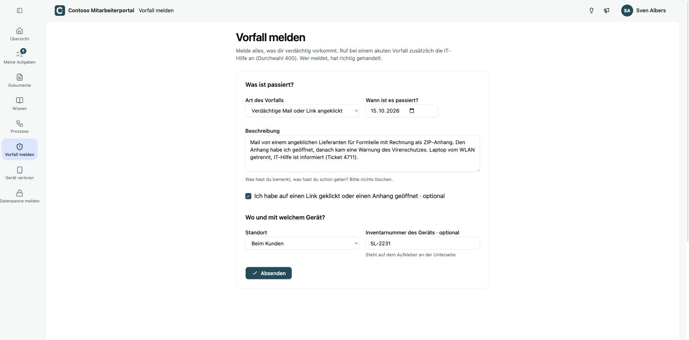
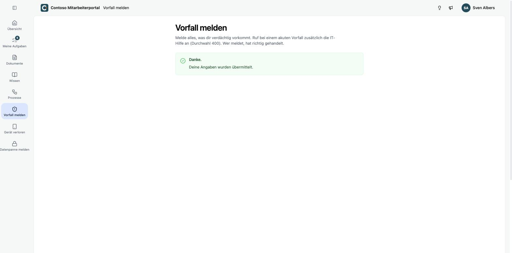
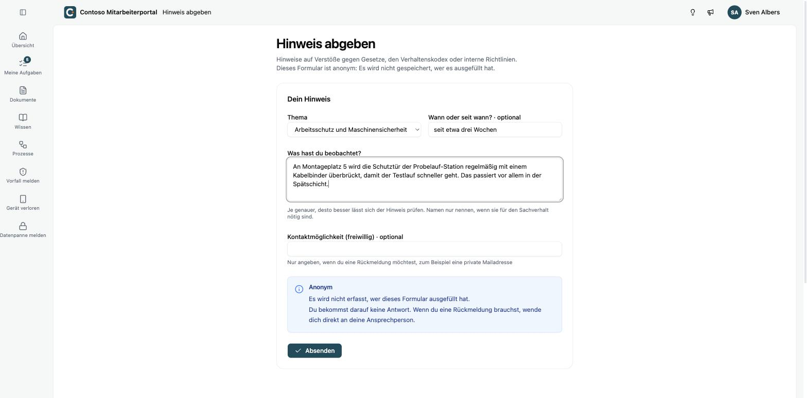

Dein Unternehmen hat im Portal Formulare eingerichtet, über die du etwas meldest. Du findest sie in der Navigation links unter den anderen Bereichen und oben rechts, zum Beispiel **Vorfall melden**, **Gerät verloren**, **Datenpanne melden** oder **Hinweis abgeben**.

Fülle die Felder aus und klicke auf **Absenden**. Felder mit dem Zusatz **optional** kannst du leer lassen. Nach dem Absenden siehst du eine Bestätigung.

<Callout title="Bei einem akuten Vorfall auch anrufen" type="warn">
Ein Formular ersetzt bei einem akuten Sicherheitsvorfall nicht den Anruf bei deiner IT. Melde dich zuerst telefonisch und fülle das Formular danach aus, so wie es dein Unternehmen vorgibt.
</Callout>

## Anonyme Formulare

Manche Formulare sind anonym, etwa für Hinweise nach dem Hinweisgeberschutzgesetz. Das steht im Formular deutlich dabei.

Bei einem anonymen Formular wird nicht erfasst, wer es ausgefüllt hat. Dein Unternehmen kann dir deshalb nicht antworten. Wenn du eine Rückmeldung möchtest, gib freiwillig eine Kontaktmöglichkeit an, falls das Formular ein Feld dafür hat, oder wende dich direkt an deine Ansprechperson.

Bei Formularen ohne diesen Hinweis sieht dein Unternehmen, wer die Meldung abgeschickt hat, und kann sich bei dir melden.
