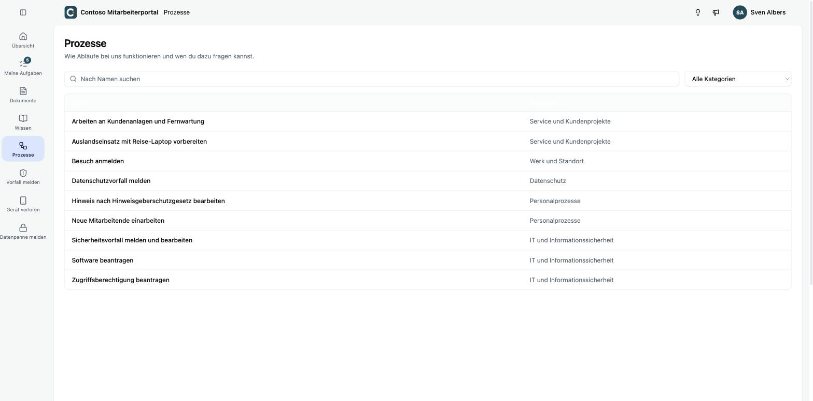
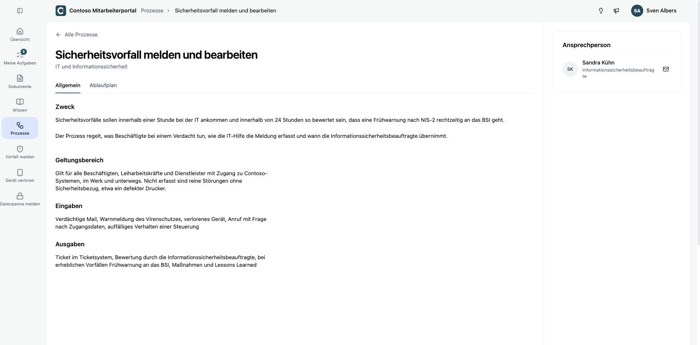
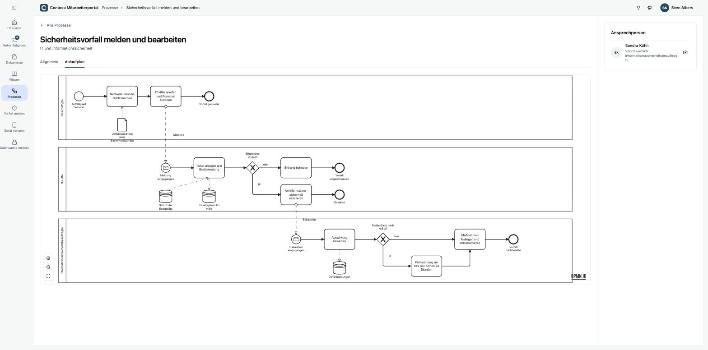

Unter **Prozesse** findest du die Abläufe, die dein Unternehmen für dich freigegeben hat, zum Beispiel wie du einen Sicherheitsvorfall meldest oder eine Berechtigung beantragst. Über die Suche und den Filter **Alle Kategorien** findest du einen Prozess schnell.

## Ein Prozess im Detail

Im Reiter **Allgemein** stehen Zweck, Geltungsbereich, Eingaben und Ausgaben des Prozesses. Rechts siehst du die **Ansprechperson**, an die du dich bei Fragen wendest.

Im Reiter **Ablaufplan** zeigt ein Diagramm, wer was in welcher Reihenfolge tut. Jede Bahn steht für eine Rolle, etwa Beschäftigte, IT-Hilfe oder Informationssicherheit. Gestrichelte Pfeile zwischen den Bahnen sind Übergaben, etwa eine Meldung an die IT.

