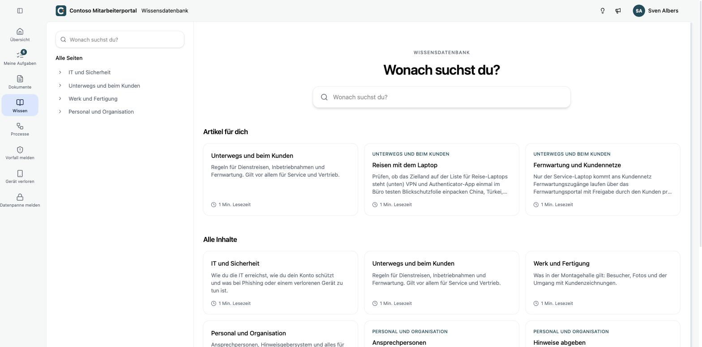
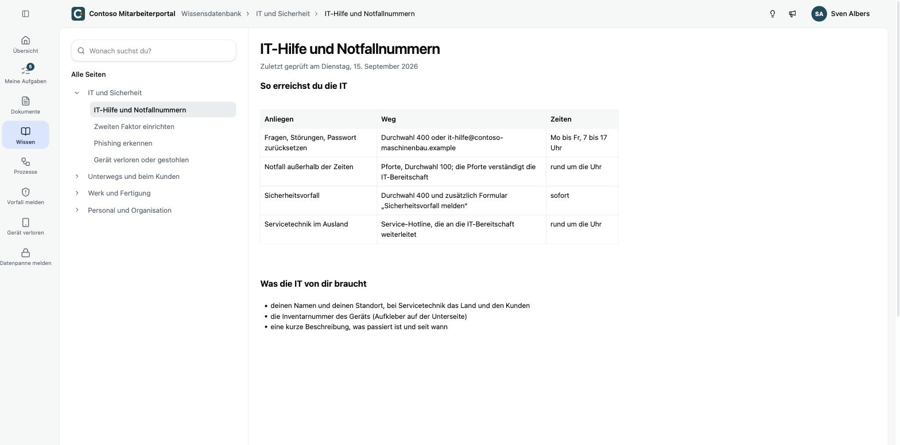

Unter **Wissen** findest du die Wissensdatenbank deines Unternehmens: wen du bei einem IT-Notfall anrufst, wie du den zweiten Faktor einrichtest, was bei einem verlorenen Gerät zu tun ist.

- Über **Wonach suchst du?** durchsuchst du alle Seiten.
- Links stehen die Themen. Ein Klick klappt die Seiten darunter auf.
- **Artikel für dich** zeigt Seiten, die dein Unternehmen speziell für deine Abteilung bereitgestellt hat.
- **Alle Inhalte** zeigt alle Seiten, die du sehen darfst.

Unter dem Titel jeder Seite steht, wann sie zuletzt geprüft wurde.
